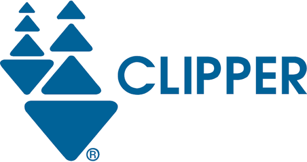

# clipper


View, edit, and convert reference trajectories from a variety of mocap sources into
formats suitable for downstream motion-tracking repos. Sources are loaded into one
canonical form — MuJoCo `qpos` in the target model's layout, plus a frame rate — and
joints are matched **by name**, so any clip can be viewed or written on any model with
a compatible skeleton (missing DOFs stay at 0).

**Entry points** (`scripts/`):

- `visualize_trajectory.py` — MuJoCo replay, or interactive slider scrubbing.
- `crop_trajectory.py` — crop → height/ankle offset → optional standing-pose pad →
  write, with optional preview and mp4 export.

## Setup

```bash
conda env create -f environment.yml   # env "clipper", Python 3.12
conda activate clipper
pip install -e .
```

`requirements.txt` mirrors the pip dependencies for non-conda installs.

### Source data (`~/.g1mocap`)

```
~/.g1mocap/
├── DefaultDatasets/      # LocoMuJoCo .npz       (40 Hz  → g1_23dof)
├── Lafan1/               # LocoMuJoCo .npz       (40 Hz  → g1_23dof)
└── bones_seed/           # Bones Studio "seed"   (120 Hz → g1_29dof)
    ├── csv/<date>/*.csv
    └── metadata/
```

`DefaultDatasets` + `Lafan1` are the Unitree-G1 retargets from
[`robfiras/loco-mujoco-datasets`](https://huggingface.co/datasets/robfiras/loco-mujoco-datasets);
`bones_seed` is the G1 CSVs + metadata from
[`bones-studio/seed`](https://huggingface.co/datasets/bones-studio/seed). Both may need
access approval first, and `bones_seed` is ~51 GB across ~142k CSVs shipped as a single
`g1.tar.gz`, so it must be fetched whole.

```bash
mkdir -p ~/.g1mocap

hf download robfiras/loco-mujoco-datasets --repo-type dataset \
    --include "DefaultDatasets/mocap/UnitreeG1/*.npz" "Lafan1/mocap/UnitreeG1/*.npz" \
    --local-dir ~/.g1mocap/_locomujoco
mkdir -p ~/.g1mocap/DefaultDatasets ~/.g1mocap/Lafan1
mv ~/.g1mocap/_locomujoco/DefaultDatasets/mocap/UnitreeG1/*.npz ~/.g1mocap/DefaultDatasets/
mv ~/.g1mocap/_locomujoco/Lafan1/mocap/UnitreeG1/*.npz          ~/.g1mocap/Lafan1/
rm -rf ~/.g1mocap/_locomujoco

hf download bones-studio/seed --repo-type dataset --include "g1.tar.gz" "metadata/*" \
    --local-dir ~/.g1mocap/bones_seed
tar -xzf ~/.g1mocap/bones_seed/g1.tar.gz --strip-components=1 -C ~/.g1mocap/bones_seed
rm ~/.g1mocap/bones_seed/g1.tar.gz        # → ~/.g1mocap/bones_seed/csv/<date>/*.csv
```

MSK clips are read in place from `~/.musclemimic/caches/AMASS/<Model>/`.

## Usage

```bash
# Inspect a clip, frame by frame, to find crop bounds and a ground offset
python scripts/visualize_trajectory.py \
    --path ~/.g1mocap/Lafan1/dance1_subject2.npz --source lafan1 --model g1_29dof \
    --mode scrub

# Crop it, raise it 3 cm, pad standing at both ends, and write an mjlab motion NPZ
python scripts/crop_trajectory.py \
    --path ~/.g1mocap/Lafan1/dance1_subject2.npz --source lafan1 --model g1_29dof \
    --start 100 --stop 400 --height-offset 0.03 --pad-standing --format mjlab
# -> outputs/mjlab/g1_29dof/dance1_subject2_crop100-400.npz
```

Outputs land in `outputs/<format>/<model>/`. Written clips are re-loadable with the
matching source id, so a converted clip can be re-viewed or re-cropped.

### `visualize_trajectory.py`

| flag | meaning |
|---|---|
| `--path` | path to reference trajectory (required) |
| `--source` | see [Sources](#sources) (required; no autodetection) |
| `--model` | see [Models](#models) (required) |
| `--mode` | `replay` (default) \| `scrub` (slider + keyboard) |
| `--fps` | playback rate override; default is the source's own rate |
| `--speed` | real-time multiplier (`2` = 2×) |
| `--no-loop` | play once instead of looping |
| `--no-floor` | hide the ground plane (no-op for MSK models, which bundle a scene) |

### `crop_trajectory.py`

| flag | meaning |
|---|---|
| `--path` / `--source` / `--model` | as above (all required) |
| `--format` | output format, see [Output formats](#output-formats) (required) |
| `--start` / `--stop` | crop bounds (0-based, inclusive; default full clip) |
| `--height-offset` | global z added to every frame (m) |
| `--ankle-offset` | global right-ankle (OSL) offset (deg); OSL models only, see [Models](#models) |
| `--bio-ankle-offset` | global biological (left) ankle offset (deg); OSL models only |
| `--pad-standing` | prepend/append a standing pose with a blended transition |
| `--pre-static`/`--pre-blend`/`--post-static`/`--post-blend` | pad durations (s); default 1.0 / 0.5 |
| `--output-fps` | resample (lerp + slerp); default keeps the source rate, **except `--format mjlab`, which defaults to 50 Hz** |
| `--name` | output file stem (default derived from source + crop range) |
| `--visualize` / `--save-video` | replay the final clip / render it to an mp4 |

### Scrub mode

`--mode scrub` opens the MuJoCo viewer plus a slider window for stepping through frames
and dialling in offsets. Keys work with the **slider window** focused.

| key | action |
|---|---|
| `a` / `d` | step −1 / +1 frame |
| `w` / `s` | jump −10 / +10 frames |
| `q` / `e` | raise / lower the global z-offset (±5 mm) |
| `z` / `c` | right-ankle (OSL) offset +1° / −1° (OSL models only) |
| `v` / `b` | biological (left) ankle offset +1° / −1° (OSL models only) |
| `r` | reset the z-offset to 0 |
| `f` | mark: print `frame k/N  t=..s  z=+..m  ankle=+..deg  bio_ankle=+..deg`, then the `crop_trajectory.py` command (minus `--format`) with `--start`/`--stop` = the last two marks and the current offsets |

Close either window to quit.

## Sources

`--source` is required and never guessed. "R/W" marks the formats clipper also writes,
which round-trip exactly.

| `--source` | reads | rate | notes |
|---|---|---|---|
| `default_datasets` | LocoMuJoCo `.npz` | 40 Hz | G1 retargets |
| `lafan1` | LocoMuJoCo `.npz` | 40 Hz | same loader as above |
| `bones_seed` | Bones Studio CSV | 120 Hz | cm→m, deg→rad, Z-up, raw height |
| `musclemimic` | MSK cache `.npz` | 100 Hz | R/W. Self-describing (`qpos`, `joint_names`, `frequency`, FK blocks) |
| `mjlab` | motion-tracking `.npz` | from file | R/W. Also reads clips written for `unitree_rl_mjlab` |
| `mj_nlp` | `qpos_<dof>dof.csv` + `time.csv` | from `time.csv` | R/W. Quat **wxyz** |
| `mj_nlp_out` | mj-nlp solver `.npz` | ~100 Hz | read-only. Solved MPC rollout (`state`) |
| `sbto` | sbto reference `.npz` | from file | R/W. Reverses the writer's `[quat, pos]` base flip |
| `sbto_out` | `best_trajectory.npz` | ~100 Hz | read-only. Optimized trajectory; accepts the run dir |
| `srb_kino` | headerless qpos CSV | 50 Hz default | read-only. Quat **xyzw**, no timing — override with `--fps` |
| `holosoma` | retargeted `.npz` | 30 Hz | read-only. Already `g1_29dof`-native; overlays the source SMPL skeleton as spheres |

## Output formats

| `--format` | writes | models | consumed by |
|---|---|---|---|
| `mjlab` | motion-tracking `.npz` (`joint_pos/vel`, `body_pos/quat/lin_vel/ang_vel_w`, `fps`) | any | [`mjlab`](../../mjlab) and its fork [`unitree_rl_mjlab`](../unitree_rl_mjlab) |
| `mj_nlp` | `qpos_<dof>dof.csv` + `time.csv` per clip | any | [`mj-nlp`](../mj-nlp) trajectory optimization |
| `musclemimic` | round-trip cache `.npz` (full FK + mimic sites) | MSK | [`musclemimic`](../../01_projpegleg/musclemimic) |
| `sbto` | reference-motion `.npz` | G1 | DynaRetarget/[`sbto`](../sbto) |

### mjlab

One format, two consumers: the two repos' `csv_to_npz.py` differ only in which scene
they build and where the result goes, and their tracking `MotionLoader`s read the
identical arrays. (This format was called `unilab` before the rename.) clipper writes
the NPZ **directly** in MuJoCo + numpy — no retargeted CSV, no `csv_to_npz` run, no
W&B registry. Training takes it as a local file:

```bash
uv run train Mjlab-Tracking-Flat-<task> \
    --env.commands.motion.motion-file <clipper>/outputs/mjlab/<model>/<clip>.npz
```

> ⭐ **Output is written at 50 Hz.** The tracking task never reads the NPZ's `fps` key —
> it advances one motion frame per env step, and tracking runs `timestep=0.005` ×
> `decimation=4` (`step_dt` = 0.02 s). A clip written at any other rate trains against a
> reference playing at the wrong speed, silently. Pass `--output-fps` only for an env
> whose `step_dt` differs.

Resampling reproduces upstream's interpolation grid, which **drops the last frame**
(522 frames at 100 Hz give 261 at 50 Hz). The body block matches the consuming
`Entity`'s body set: the G1 models use the vendored scene XML's 30 bodies (the
`g1_23dof` scene pads 6 dummies to match), every other model its own. **mjlab cannot
consume an MSK clip yet** — it has no OSL `Entity`, and its stock converter is G1-only;
that import is mjlab-side work.

## Models

`--model` is required. Any source can be played on any model with a compatible
skeleton. MSK models come from [`musclemimic`](../../01_projpegleg/musclemimic),
[`myo_sim`](../../01_projpegleg/myo_sim) and
[`myoassist`](../../01_projpegleg/myoassist), vendored under `assets/msk/`; all are
free-base, and the full-body ones load with their 40 finger joints disabled (matching
musclemimic's default), which is what makes their `nq` match the caches.

| `--model` | model | nq | driven by |
|---|---|---|---|
| `g1_29dof` | Unitree G1, 29 DOF | 36 | any G1 source |
| `g1_23dof` | Unitree G1, 23 DOF | 30 | any G1 source |
| `myolegs` | MyoLegs (biological, myo_sim) | 35 | `MyoLeg80_OSL_KA` cache ¹ |
| `myofullbody` | full-body MyoSkeleton | 89 | `MyoFullBody` cache |
| `osl_fullbody` | myoassist full-body + OSL knee-ankle export, lengthened shank | 80 | `MyoFullBody` cache ² |

¹ `myolegs` has no clips of its own; the OSL_KA cache's prosthetic knee/ankle are
renamed back to the biological joints, the `socket_*` DOFs dropped, and the right-knee
couplers left at 0 (a minor visual approximation).

² The NeuMoVe Lab export built with myo_sim 0.2.3, with the OSL tibial pylon lengthened
22.5 mm so the prosthetic leg matches the intact one (provenance and edits in
`assets/msk/osl_fullbody/README.md`). Welded socket, 5 real keyframes (so
`--pad-standing` seeds from the authored `stand` pose). The prosthesis is driven from
the source's **biological** right knee/ankle; the other amputated-leg DOFs (knee
couplers, subtalar, mtp) drop. Its OSL joints carry an `OSL_KA_L1_` prefix and its
elbows are `elbow_flexion_*`, both handled by a rename table.

**Ankle corrections.** OSL joints are driven by raw biological measurements, so the
prosthetic foot may not sit flat, and the intact foot may need the same touch-up. Dial
them in with the scrub window's R-ankle (OSL) slider (`z` / `c`) and L-ankle (bio)
slider (`v` / `b`), then bake them with `--ankle-offset <deg>` and
`--bio-ankle-offset <deg>` (clip suffixes `_ankle±N` / `_bioankle±N`). Applies to
`osl_fullbody` only; other models have no sliders and the flags error on them.

## Assets

`assets/robots/unitree_g1/` is imported from `unitree_rl_mjlab`
(`src/assets/robots/unitree_g1/`):

| clipper file | upstream file |
|---|---|
| `xmls/g1_29dof.xml` | `g1.xml` (29-DOF, bare) |
| `xmls/g1_23dof.xml` | `g1_23dof.xml` (23-DOF, bare) |
| `xmls/scene_g1_29dof.xml` | `scene_g1.xml` (29-DOF + floor) |
| `xmls/scene_g1_23dof.xml` | `scene_g1_23dof.xml` (23-DOF + floor) |
| `xmls/assets/*.STL` | same (38 meshes) |
